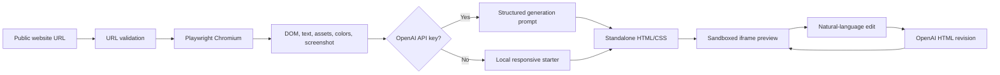

# Sitecraft AI

Turn a public website URL into a responsive, editable frontend. Sitecraft inspects a page in Chromium, captures its visible content and visual cues, creates a fresh HTML/CSS implementation, and previews it in an isolated browser frame. Add a Gemini API key to enable higher-fidelity generation and natural-language edits; a local template keeps the generation flow demonstrable without a key.

## Run locally

Requirements: Node.js 20+ and npm.

```bash
npm install
npx playwright install chromium
Copy-Item .env.example .env
# Optional: set GEMINI_API_KEY in .env to enable AI generation and edits
npm run dev
```

Open the Vite URL printed in the terminal (normally `http://localhost:5173`). The API runs on port 8787. For a production-style local run, use `npm run build` followed by `npm start`, then open `http://localhost:8787`; the Express server serves both the built frontend and API from one port.

## Architecture



## Design decisions

- **Stack:** React, TypeScript, Vite, Express and Playwright. The generation target is a self-contained HTML document, which makes the MVP quick to render and export while keeping the generated site independent of the original page.
- **Analysis:** Playwright launches headless Microsoft Edge on Windows (with its managed Chromium as a fallback), loads the submitted URL, and extracts title, description, visible headings and sections, navigation links, images, computed colors, fonts and a viewport screenshot. Structured content is sent to the model; the screenshot is available in the UI for inspection.
- **Model:** Gemini `generateContent` REST API, default model `gemini-3.8-flash`, configurable with `GEMINI_MODEL`; a 503 overload retries once, then falls back to `gemini-3.5-flash-lite` (configurable with `GEMINI_FALLBACK_MODEL`). The API key stays on the server and is sent in the `x-goog-api-key` header. Without a key, generation uses an analysis-driven starter template; natural-language edits require the API.
- **Preview:** The document runs in a sandboxed iframe, and users can switch desktop, tablet and mobile widths, inspect extracted analysis and export the HTML.
- **Safety and errors:** The analyzer rejects local/private IP targets and checks navigated resource URLs. API inputs are bounded, AI output is validated, and errors are returned to the UI.

## Limitations

- Browser-based visual analysis is limited to the initial viewport screenshot and extracted DOM; canvas-heavy or authenticated sites may not expose useful structure.
- Recreated output is a new static frontend, not a copy of the source app's backend behavior. Dynamic interactions, complex animation and exact responsive breakpoints may differ.
- Remote images/fonts require network access in the preview. Source websites may block automated browsing or hotlinking.
- The MVP does not persist projects. AI requests send the extracted public-page text and image URLs to the configured model provider. Review provider privacy and usage settings before processing sensitive content.
- URL filtering reduces local-network access risk but is not a replacement for hardened network egress controls in a multi-user hosted service.

## Demo walkthrough

1. Paste a public URL and click **Build website**.
2. Show the captured source screenshot and section outline with **Details**.
3. Switch the preview between desktop, tablet and mobile.
4. Apply an edit such as “Make the navbar sticky and change the primary color to blue.”
5. Export the generated HTML.
